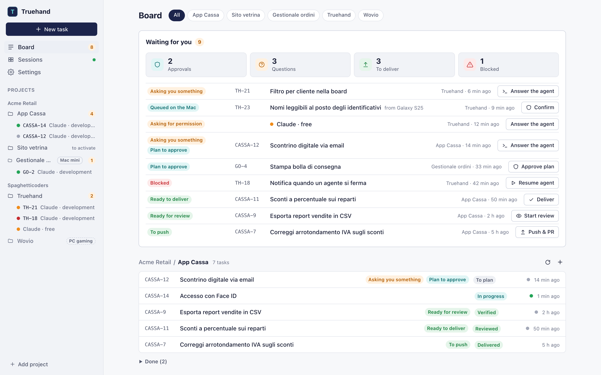
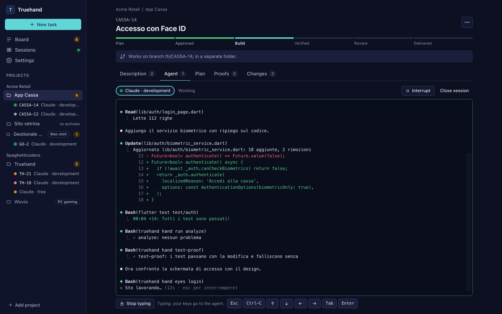
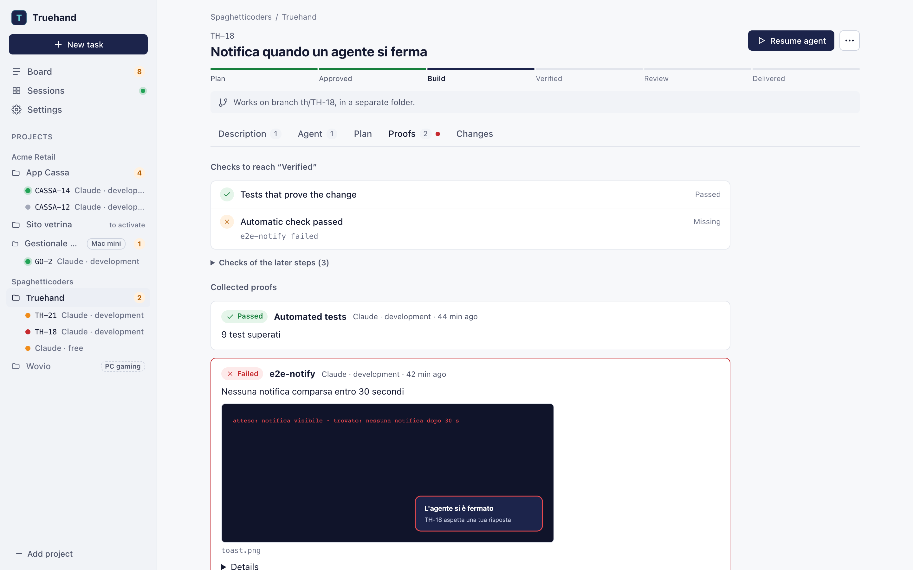
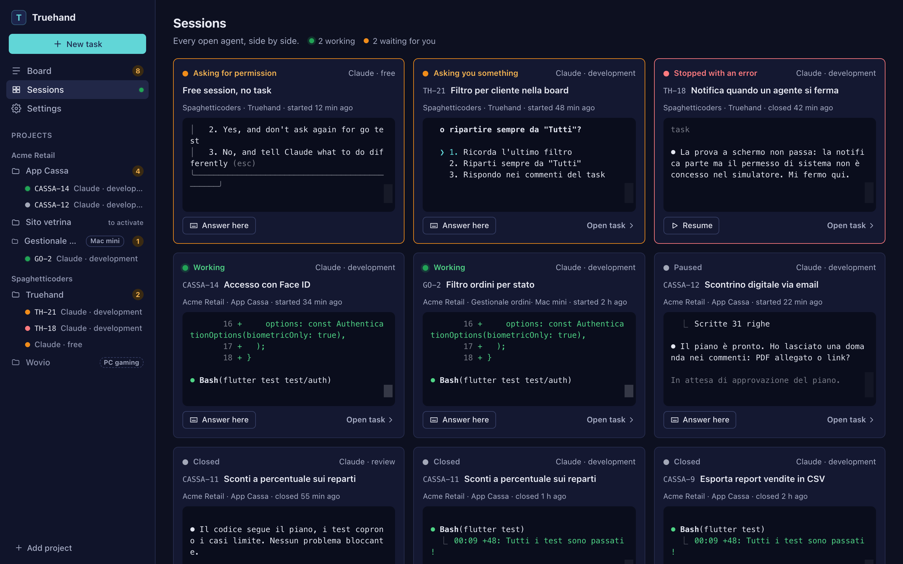
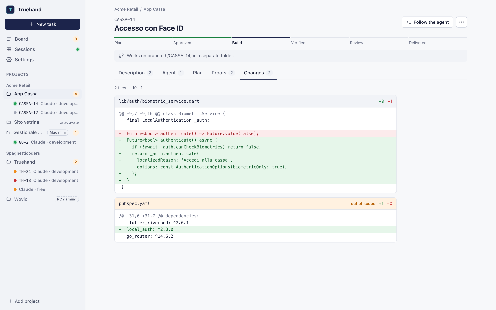
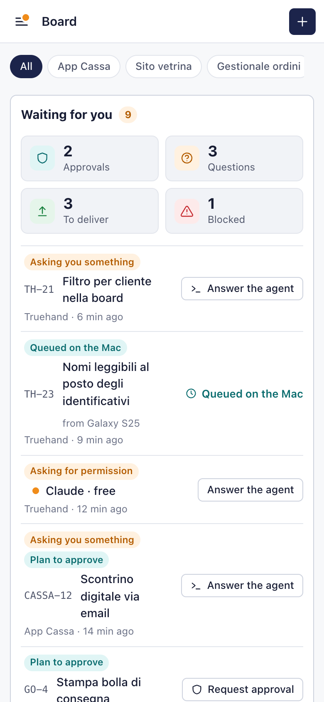
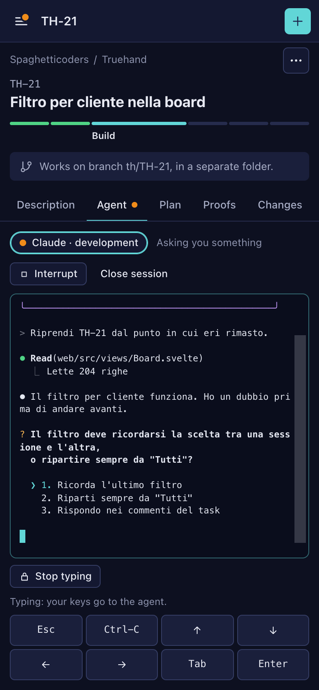

# Truehand

Reliable hands for AI coding agents.

<p align="center">
  
</p>

Claude, OpenClaw, Hermes and the rest are general-purpose robots: they decide *what* to do.
Truehand gives them hands that do it *the same way every time*, and a board with gates so
work cannot move forward without evidence:

```
planned ──▶ approved ──▶ building ──▶ verified ──▶ reviewed ──▶ delivered
   plan +      human          code      hands'       someone      conventional
   approval    only                    evidence      else         commits, CI lock
```

| Hand | What it proves |
|---|---|
| `plan fetch` | The plan starts from the whole task, comments included — and from the linked Linear/GitHub ticket, if any |
| `hand test-proof` | The tests pass with the change **and fail without it** |
| `hand eyes` | The real screen matches its Figma node: pixel diff + every visible text |
| `hand run <name>` | Any command (analyze, lint, build), run by Truehand, exit code recorded |
| `hand attach` | Screenshots or files the agent looked at, kept on the task for the humans |
| `review` | A review exists, by someone who did not work on the task |

- **Agent-agnostic.** CLI + MCP server; the Claude Code plugin, loaded by the app's sessions,
  adds the locks.
- **No LLM inside.** Hands are deterministic code. Judgement stays with the user's agent,
  on the user's own subscription. Truehand never touches Claude credentials.
- **Evidence, not claims.** Each hand writes files plus a record of the exact content it ran
  on. Change a file afterwards and the evidence goes stale; edit the evidence and it reads
  as tampered.
- **Human approval means a human.** `truehand approve` asks the operating system to
  authenticate you (password or Touch ID); an agent running as your user can run commands
  but cannot answer that dialog.
- **Three locks.** Agent hooks keep agents on the path (no push, no commit before review, no
  edits to Truehand's files, no "done" with unverified work) — a soft lock that stops
  mistakes and shortcuts; managed settings for companies; and `truehand ci verify`, the
  merge lock, which re-checks everything on the pushed content with the base branch's gates.

## Install

```sh
go install github.com/spaghetticoders/truehand/cmd/truehand@latest
```

The Claude Code plugin (hooks, MCP tools, skills) ships inside the binary: sessions started
from the Truehand app load it with `--plugin-dir`, so nothing is installed in your Claude Code
config. If you installed it globally in the past, remove it — its hooks would run twice:

```
claude plugin uninstall truehand@truehand
```

## Quick start

```sh
cd your-repo
truehand init                      # .truehand/config.yaml for your stack
truehand hook install              # commit-msg + pre-push git hooks
truehand task new --title "Login screen" --description "Email + password, remember me."
                                   # → T-1; the task is the ticket. Linked tracker optional:
                                   #   --source linear:SPA-123
truehand plan fetch                # context.md with description and comments + plan.md
# …the agent fills plan.md…
truehand approve                   # you, after OS authentication → approved (repos with approvers: in the app)
truehand task move building
# …the agent builds, then runs the hands…
truehand hand test-proof
truehand hand run analyze
truehand hand eyes login
truehand task move verified
# …someone else reviews…
truehand review --verdict pass --notes review.md
truehand task move reviewed
git commit -m "feat(auth): new login screen"
truehand task move delivered
```

`truehand task show` always says what the next gate is missing.

## The app

Truehand for Mac (`make shell`, or the DMG) is a thin window around one binary,
`truehand serve --app`, which it starts as a daemon (closing the window leaves agents
running) and signs in to with a token kept in the Keychain.

| Task with the agent's live terminal | Evidence the gate checks |
|---|---|
|  |  |
| **Every agent, side by side** | **The task's changes** |
|  |  |

<p align="center">
  
  &nbsp;
  
</p>

- **Projects** are grouped by client and live in `~/.truehand/app`. Adding a repo offers
  **Activate Truehand**: rules (`.truehand/config.yaml`), git hooks, then **Commit config** on
  the base branch, showing exactly the text and the approvers being committed.
- **Tasks** each get a branch `th/<id>` and a worktree in `~/.truehand/worktrees`, so several
  agents work on one repo at once. One button per state: start agent, approve plan, start
  review (a second session, never the one that wrote the code), push and PR; "Send back"
  with a reason the agent reads.
- **Agents** are real Claude Code sessions in terminals you watch and type into (Agent tab,
  Sessions page). They load the plugin with `--plugin-dir`, report their status through
  `--settings` hooks, and start in `default`, `acceptEdits` or `plan` permission mode — never
  one that skips prompts. **Waiting for you** collects what needs you: plans, questions,
  permissions, reviews, pushes.
- **Human approval** is asked every time, not once: approving a plan, pushing and opening a
  PR raise the OS dialog on the Mac (Touch ID or password). In a repo whose base branch lists
  `approvers` ([docs/config.md](docs/config.md#signed-approvals)), they need a signature from
  the Mac app's Secure Enclave key instead. The token alone never approves.
- **Phone.** Settings → pair a phone: a one-time code (or QR) valid for two minutes gives the
  phone its own revocable access. Turn on tailnet access in Settings to reach the Mac over
  Tailscale (the server otherwise listens on 127.0.0.1 only). From the phone, approvals,
  pushes and PRs go into a queue you confirm at the Mac, or are signed right there with a
  passkey ([below](#approve-from-your-phone)).

Without the Mac app, `make app && bin/truehand serve` serves the same UI on 127.0.0.1 and
prints a token to sign in with; approvals, pushes and PRs then wait in the queue until you
confirm them in the Mac app. Inside an agent session `serve` is read-only.

The Flutter app in `app/` is legacy: it spoke the old `serve` API and no longer works.

### Remote machines

Projects can live on other computers reached over ssh (a Mac mini, a Linux box on the
tailnet). Add one in Settings → Machines, or:

```sh
truehand machine add mac-mini.example.ts.net --label "Mac mini"
truehand machine list
truehand machine update <machine>     # after upgrading truehand on the Mac
```

The Mac copies its truehand into the remote `~/.truehand` and starts `truehand serve --peer`
there, which listens only on a unix socket; the Mac talks to it through
`ssh <target> ~/.truehand/bin/truehand peer-proxy`. Agents run on the remote machine; you
follow them from the Mac or the phone. Approving, pushing and opening PRs on a remote project
need signed approvals: add the Mac app's key to `approvers` in that repo's config on its base
branch.

### Approve from your phone

A passkey makes any device an approver: the fingerprint or face on an Android phone or an
iPhone, Touch ID or Windows Hello in a desktop browser, or a FIDO2 security key. Nothing is
platform specific; ES256 and RS256 passkeys both work, and one person can register several.

Passkeys need HTTPS, which `tailscale serve` provides: turn on access through tailscale serve
in Settings and open Truehand from its `https://<machine>.<tailnet>.ts.net` address. Then
Settings → Passkeys → **Add this device**, or **Code for another device** (a QR and a one-time
code valid for a few minutes) to enrol a phone. A passkey plays two roles:

- **Owner of the server**: it stands in for the Mac's Touch ID on this server (pairing
  devices, settings, committing a config with no approvers yet). The first owner is
  released by the Mac, or on a server without one by `sudo truehand passkey bootstrap`.
- **Approver of a project**: "Make it an approver" adds its public key to the project's
  `approvers`; you then sign the commit of the rules on the base and their push from the
  same device. From then on plans, pushes and PRs of that project are signed with the
  passkey, from wherever you are ([docs/config.md](docs/config.md#approvers)).

### Run on a Linux server

Truehand runs headless on a Linux machine of the tailnet, with no screen and no Mac:

```sh
truehand linux install        # systemd --user unit, loginctl enable-linger, tailscale serve
truehand linux install --dry-run   # print the unit and the commands, change nothing
sudo truehand passkey bootstrap    # at the server's own terminal: first owner passkey
sudo -k                            # forget the cached sudo credentials
sudo truehand passkey revoke <id>  # revoke an owner passkey for good (root's list)
sudo truehand passkey revoke --repair  # rewrite that list if it is damaged, revoked ids kept
```

`linux install` runs as your user: it writes `~/.config/systemd/user/truehand.service`
(`serve --headless` on 127.0.0.1, started through your login shell so PATH has nvm, npm and
`~/.local/bin`), enables linger so it survives logout, and publishes it with
`tailscale serve --https=443` (once: `sudo tailscale set --operator=$USER`).

`passkey bootstrap` prints a one-time code (valid 10 minutes) and the enrolment address on
the terminal, never in a log; open the address on the phone, type the code, create the
passkey: it becomes the server's owner. Run it from a terminal where no agent runs (the
console, or ssh with a tty). It refuses when your account can use sudo without a password,
since your agents could then make an owner too; `sudo -k` afterwards drops the sudo
credentials cached for a few minutes. On a headless server human actions need an owner's
or an approver's passkey: there is no OS dialog to fall back on.

A passkey is a human factor only while the server is out of the agents' reach. If the agents
run as the same Unix user, one of them can replace the server's binary or put its own page at
the same address, and your phone will sign what that page asks. Run the agents as another
Unix user that cannot write `~/.truehand` nor kill the server, and keep CI with PR review as
the lock ([docs/SPEC-v0.md](docs/SPEC-v0.md), §7).

### From a terminal: sessions / attach

```sh
truehand sessions                 # agent sessions on this Mac and its machines (--all: ended too)
truehand attach <session>         # this terminal becomes the agent's; Ctrl-] detaches
truehand attach <session> --view  # watch only
```

Both talk to the app's server over `~/.truehand/app/serve.sock`, so they work in any
terminal or multiplexer pane (herdr included) and over ssh on the Mac. Approvals are never
available there, and an agent calling them gets a read-only view.

## Docs

- [docs/SPEC-v0.md](docs/SPEC-v0.md) — concepts, files, gates, hands, locks
- [docs/config.md](docs/config.md) — every config option
- [docs/ci.md](docs/ci.md) — the merge lock in GitHub Actions

## Build

```sh
go build -o bin/truehand ./cmd/truehand   # CLI only, without the web UI
make app                                  # bin/truehand with the web UI embedded (needs bun)
make shell                                # Truehand.app + DMG in shell/src-tauri/target/release/bundle (needs cargo, Xcode)
make e2e                                  # bin/truehand-e2e for browser tests only: fake OS auth, temporary HOME, never ship it
make dist                                 # bin/truehand-<os>-<arch> for remote machines
make test                                 # go vet + go test ./...
cd web && bun run check                   # web UI type check
```
